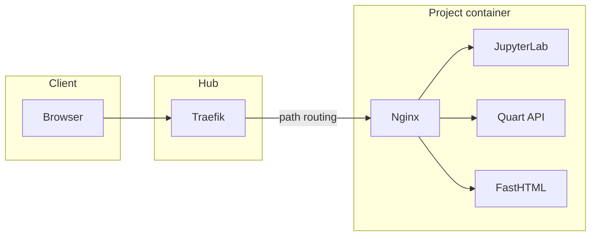

# Katapult

Katapult creates an isolated development environment that can be
configured to include a [JupyterHub](https://jupyter.org/hub) server,
a [Quart](https://palletsprojects.com/projects/quart) api service,
a [fasthtml](https://www.fastht.ml/) webapp, and the template for a python library.
In addition, [Quarto](https://quarto.org/) is used to create static websites that
integrate easily with github pages and provide downloadable html files of
jupyter notebooks.

[view on github pages](https://ajp619.github.io/katapult/)

## Description

Katapult creates an isolated environment for each project that is easily
portable from your laptop to any network infrastructure. It provides a single container
that has the following tools:

* [JupyterHub](https://jupyter.org/hub) / **JupyterLab**: Explore data, prototype transformations
  and models, and make publishable reports.
* [Quart](https://palletsprojects.com/projects/quart): Create an api that allows
  programmatic access to information generated by your service.
* [fasthtml](https://www.fastht.ml/): Create dashboards and tools to help others
  gain insight from your work.
* [Quarto](https://quarto.org/): Publish stand alone, interactive reports that can be
  downloaded and distributed in various formats. Create project documentation using
  Markdown and Jupyter.
* **Nginx**: Acts as a reverse proxy within the container to route requests to the appropriate services.

It takes an opinionated view of the typical development process and provides many
convenience functions to facilitate this process.

## Architecture

1. **Hub container (Traefik)**: A central Traefik reverse proxy container routes requests to individual projects via path-based routing (e.g. `http://localhost/project_name/`).
2. **Project containers**: Each project runs in its own Docker container with all services managed by Supervisor.
3. **Docker networking**: Projects connect to a shared `katapult` Docker network for automatic routing.



## Getting Started

### Dependencies

* *nix environment (e.g. linux, macOS). On Windows use wsl2.
* docker
* Python 3.12
* pipx

### Installing

Install from github:

```bash
pipx install "git+https://github.com/ajp619/katapult#subdirectory=lib"
```

### Quickstart

Enable `katx` (see [CLI Reference](#cli-reference)):

```bash
kat config
```

Launch entry point container:

```bash
kat hub
```

Create a new project from the katapult template with:

```bash
kat init
```

Enter the project name and accept the rest of the defaults. This will create a
new directory for your project.

To create a project **non-interactively** (e.g. when an orchestrator or script drives
creation), pass `--yes` with any values you want to set; the slug is derived from the name:

```bash
kat init --yes --name "Lead Score" --python 3.12 --output-dir ~/git
```

`--name`, `--python`, `--host`, and `--output-dir` are all optional; anything omitted falls
back to the template default.

Change to the new project directory and use:

```bash
katx run
```

This will build the container, launch it, render the static content, and show you the
status of the services.

You can now access the container at `http://localhost/<project name>/`

## CLI Reference

There are two commands: `kat` and `katx`.

### `kat` (high-level management)

Use `kat` for creating projects and managing the hub container that exposes all projects
as path extensions (e.g. `http://localhost/<project name>/`).

| Command | Description |
| --- | --- |
| `kat init` | Creates a new project from a cookiecutter template |
| `kat hub` | Manages the Traefik reverse proxy container |
| `kat config` | Sets up dynamic PATH augmentation for `katx` in `.bashrc` (see [`kat config`](srv/kat.qmd#kat-config)) |
| `kat export-docs` | Renders a project's docs to a self-contained HTML zip in `~/outputs` |
| `kat install-agent` | (dev-only) Installs a project's opt-in MCP agent backend via `uv sync --extra <backend>` (see [MCP server](#per-project-mcp-server-dev-only)) |
| `kat register-mcp` | Registers a project's `/mcp` endpoint into an MCP client config (e.g. `.cursor/mcp.json`) |
| `kat upgrade` | Upgrades an existing project's scaffolding to the latest template via versioned migrations (see [below](#upgrading-existing-projects)) |

```bash
kat --help
```

#### Distributing documentation

Hand someone a runnable copy of a project's documentation without giving them
access to a server, Python, or Quarto:

```bash
kat export-docs path/to/project
```

The first run builds a small Quarto-only Docker image (`katapult/export-docs:latest`);
subsequent runs reuse it. The output lands at
`~/outputs/<project_name>_docs_<YYYYmmdd_HHMMSS>.zip`. Unzip on any machine and
open the pages directly from `file://` — no local web server required.

> An internet connection is needed for Mermaid diagrams (loaded from a CDN).
> Quarto's local search box won't function over `file://` because most browsers
> block its XHR; the rest of the site (navigation, cross-links, syntax
> highlighting, embedded notebook outputs) works regardless.

#### Upgrading existing projects

Projects generated by an older katapult release drift from the current template (for
example, pre-MCP projects lack the `mcp/` server and its wiring, and older projects have no
`.cursor/rules/`). `kat upgrade` closes that gap by applying ordered, **idempotent,
scaffolding-only** migrations — it only ever touches `.katapult/`, `.cursor/`, `build/`,
and `mcp/`, never your `lib/`, `nbk/`, `api/`, or `app/` code. The current migrations add
the internal MCP server (`0001`) and seed the project's `.cursor/rules/` — engineering
standards, conventions, and notebook/jupytext standards (`0002`).

Each project records what it has received in `.katapult/manifest.json`:

```json
{ "katapult_version": "0.11.1", "applied_migrations": ["0001_add_internal_mcp"] }
```

Fresh projects are stamped at `kat init`; an unstamped project is treated as a baseline so
every migration is pending. Always preview first, then apply from a clean git tree:

```bash
kat upgrade path/to/project --dry-run   # show exactly what would change
kat upgrade path/to/project             # apply (refuses on a dirty git tree)
```

Behavior and flags:

* **Clean-git guard.** Apply refuses to run on a dirty working tree (or a non-git
  directory) so you always have a `git restore` rollback. Override with `--allow-dirty`.
* **Never clobbers.** Agnostic files (e.g. `.katapult/katx`) are refreshed wholesale, but
  a locally customized file is left untouched and the new version is written beside it as
  `<file>.katapult-new` (or `<file>.katapult-patch` for an in-place block whose anchor
  moved) for you to merge.
* **Idempotent.** Re-running applies only what's still pending; a fully upgraded project
  reports "Already up to date".
* `--to <migration-id>` stops after a specific migration instead of applying all pending.

After upgrading, rebuild the container to pick up the new scaffolding, and (for the MCP
migration) optionally wire the hub:

```bash
path/to/project/.katapult/katx rebuild
kat register-mcp path/to/project
```

##### Authoring a migration

Migrations live in `lib/src/katapult/migrations/`. To add one for a future release:

1. Create `mNNNN_<slug>.py` exposing a module-level `migration = Migration(...)` built
   from declarative `AddFile` / `EnsureBlock` actions.
2. Append it (in order) to `REGISTRY` in `migrations/__init__.py`.

Keep file *bodies* single-sourced from the project template via `AddFile` (rendered with
the project's reconstructed cookiecutter context when `templated=True`) rather than pasting
content into the migration; use `EnsureBlock` for idempotent, anchored insertions into
existing files. The runner handles dry-run, the clean-git guard, the scaffolding
allowlist, and sidecars for you.

### `katx` (project-level management)

`katx` manages each individual project. Enable it with `kat config`; that adds code to your
`.bashrc` so `katx` is on your PATH when you enter a project directory.

| Command | Description |
| --- | --- |
| `katx run` | Builds the container, starts services, renders static content, and shows status |
| `katx build` | Builds the Docker image |
| `katx up` | Starts services via docker-compose |
| `katx down` | Stops services |
| `katx connect` | Opens a shell in the container |
| `katx render` | Renders Quarto documentation |
| `katx status` | Shows service status via supervisorctl |
| `katx jlab` | Lists JupyterLab access URLs with tokens |
| `katx mcp` | Prints the project's MCP endpoint URL and service status |
| `katx restart` / `katx rebuild` | Shortcuts for down, build, up |

From within the project directory or a subfolder:

```bash
katx --help
```

## Project Structure

Each generated project contains:

* `api/` — Quart API service code
* `app/` — FastHTML webapp code
* `lib/` — Python library code
* `nbk/` — Jupyter notebooks directory (report notebooks are [jupytext](https://jupytext.readthedocs.io)-paired to percent `.py` under `nbk/reports/py/`)
* `mcp/` — (dev-only) neutral MCP server exposing project operations as MCP tools (see [below](#per-project-mcp-server-dev-only))
* `build/` — Docker configuration (Dockerfile, docker-compose.yml, supervisor configs)
* `.cursor/rules/` — editor/agent rules shipped with the project: engineering standards (uv, docs, security), project conventions, and notebook standards
* `.katapult/` — Contains the `katx` script (dynamically added to PATH when in the project directory)
* `srv/` — Quarto documentation source files
* `docs/` — Rendered documentation output

## Service Management

Services within each container are managed by **Supervisor**, which runs:

* JupyterLab server
* Quart API server
* FastHTML webapp
* Nginx reverse proxy

All services are reachable through the unified interface at `http://localhost/<project_name>/` with different paths for each service.

## Per-project MCP server (dev-only)

Each project ships a small, **IDE-neutral** [MCP](https://modelcontextprotocol.io) server
in its own `mcp/` environment. It exposes the operations every katapult project has — run
tests, render docs, check/restart services, and exchange files through a `.handoff/`
directory — as MCP tools over the existing Traefik route at
`http://localhost/<project_name>/mcp`. Any MCP-capable client (Claude Desktop, a CLI, an
SDK, Cursor) can drive a project through it. Check it with `katx mcp`.

Like `katx`, the server is **vendored and standalone**: it is maintained once in the
template, copied into each project at `kat init`, and runs on the project's own files
(`cd /content/mcp && uv run project-mcp` under Supervisor) with no runtime dependency on
the katapult library. Its core depends only on the open `mcp` package.

**Optional "second brain" backend.** When enabled, the server also exposes a
`delegate(task)` tool that drives a project-local coding agent (e.g. the Cursor SDK) with
the project's own `.cursor/rules`/`cursor_context/` loaded. This backend is **opt-in and
pluggable** — installed as an extra (`kat install-agent`, i.e. `uv sync --extra <backend>`)
and absent by default, so the server stays vendor-neutral out of the box.

Toggles (in `build/`):

| Setting | File | Default | Purpose |
| --- | --- | --- | --- |
| `MCP_SERVER` | `build/BuildConfig` | `on` | Build the MCP service into the dev image; `off` disables it |
| `AGENT_BACKEND` | `build/agent.env` | `none` | Selects the opt-in `delegate` backend (`none` omits the tool) |

Everything here is **dev-only**: the MCP service and any agent backend are wired only on
the dev compose path, so test/prod images stay agent-free. The backend credential (e.g.
`CURSOR_API_KEY`) lives only in the gitignored `build/.agent_credentials` env_file and is
never baked into the shared image. Opinionated/vendor activation (flipping
`AGENT_BACKEND=cursor`, the credentials template, org-specific tools) belongs in the
`~/.katapult/template/` overlay rather than the neutral public template.

## Key Features

* **Isolated environments**: Each project runs in its own container, portable from laptop to network infrastructure
* **Opinionated structure**: Convenience functions aligned with a typical development workflow
* **Single container**: All services run in one container per project
* **Automatic routing**: Traefik discovers and routes to new projects
* **Dynamic PATH**: The `katx` command is available when you enter a project directory

## Version History

* 0.1
  * Initial Release

## License

This project is licensed under the MIT License - see the LICENSE.md file for details
